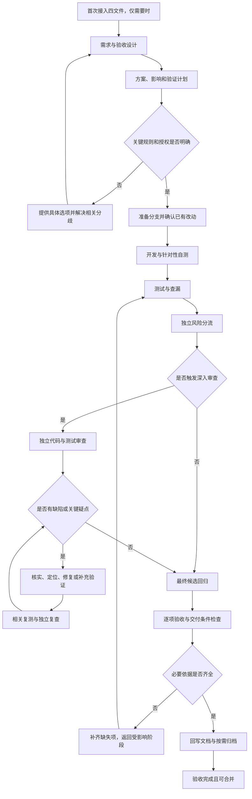

# 四文件工作流使用指南：从项目接入到 AI 阶段交接

核对日期：2026-11-10。适用对象：使用 AI 开发项目，希望知道每一步怎么开始、检查什么、如何换 AI 继续的人。

本文依据本机已安装的 `four-file-workflow`（四文件工作流）技能及模板编写，并单独说明 `E:/qt/xiangmu` 项目的适配规则。它是使用说明，不自动修改项目协作规则，也不代表本文示例需求已获授权或已经实现。

**本指南的使用原则：长期维护项目事实与必要约束；本次怎么做、怎么检查、怎么交接，由 AI 按任务生成提示词。用户用自然语言说明目标，不承担阶段提示词的编写工作。**

详细阶段说明用于帮助理解和供 AI 按需参考，不要求把整套步骤复制进每个项目、每个任务的记录或每段交接词。

## 阅读入口

- 想减少流程维护、又不擅长写提示词：先看[内容归属与持久化边界](#二四份文件分别怎么用)，再用[第五章默认入口](#五推荐的日常用法)，其余模板交给 AI 按需参考。
- 第一次使用：先看[技能职责](#一先弄清技能的职责)和[如何开始](#三第一次怎么开始)。
- 已经采用四文件，准备开发：直接看[推荐的日常用法](#五推荐的日常用法)。
- 希望每阶段由不同 AI 接力：重点看[让 AI 自己生成交接词](#六让-ai-自己生成交接词)和[十二阶段操作手册](#七十二阶段操作手册)。
- 想直接复制提示词：看[如何开始](#三第一次怎么开始)、[日常用法](#五推荐的日常用法)、[交接生成指令](#六让-ai-自己生成交接词)、[逐阶段指令](#七十二阶段操作手册)和[常用短指令](#十一常用短指令)。
- 在当前 Qt 项目里使用：先看[当前项目的具体用法与差异](#九当前项目的具体用法与差异)。
- 判断 AI 是否真的完成：看[检查交接词与完成结论](#十检查交接词与完成结论)。

**最短操作路径：** 直接说你想解决的问题，再说“按四文件规则推进，提示词和交接内容由你生成，临时过程不要新增文档维护”。AI 自行核对项目、判断当前阶段并开展已授权工作。需要换 AI 时，你只需说“帮我交接”；若没有获授权的自动传递能力，你复制 AI 生成的整段内容即可。

## 一、先弄清技能的职责

### 1.1 一句话说明

这个技能负责把项目接入四文件工作方式，以及归档已经结束的需求；接入之后，日常开发按照项目自己的 `AGENTS.md`（协作规则）运行。

你不需要每开发一个功能都重新初始化，也不需要每天让 AI 重写四份文档。

实际使用关系如下：

| 层次 | 负责什么 | 使用时机 |
|---|---|---|
| `four-file-workflow`（四文件工作流技能） | 初始化缺失文件，按授权整合已有内容，归档结束的需求 | 首次接入、明确要求更新工作流、归档 |
| 项目的四份文件 | 保存本项目的目标、业务规则、待办和协作方式 | 日常开发的事实与规则入口 |
| 当前需求的必要变更记录 | 保存无法由现有需求、代码、测试或报告承载的重要依据 | 确有跨阶段留存需要时；不是每个任务的固定产物 |
| 阶段技能 | 提供需求分析、计划、测试、审查等具体方法 | 当前阶段需要，且环境实际可用时 |
| 交接词 | 把已有事实、边界和下一步传给接手者 | 用户选择换 AI、换会话，或明确要求输出时 |

### 1.2 这个技能会做什么

初始化时，它应该核对项目根目录，检查四份文件是否存在，只创建缺失文件。已有同名文件时，保留原有内容；得到整合授权后，才局部调整。

它应根据实际项目资料填写目标、环境、构建入口和测试入口。无法核实的信息写“待确认”，不能把模板里的占位内容当成项目事实。

归档时，它应先把业务结论和长期知识写回相应文档，再移动已结束的变更目录，修正引用并核验结果。归档保留过程材料，不替代解决缺陷和验收缺口。

### 1.3 不能从技能名称推导出的事情

- 安装技能不等于项目已经接入，需要实际检查四文件内容。
- 存在四个同名文件不等于迁移完成，需要核对职责、引用和原有规则。
- 初始化完成不等于功能已实现、测试通过或业务验收完成。
- 调用审查技能不等于已经有独立审查者看过实际代码。
- 输出交接词不等于已经创建新会话，也不等于接手者已经收到文件。
- 完成开发不包含默认提交、推送、合并或发布；这些按用户实际授权处理。
- 技能更新不自动更新旧项目的 `AGENTS.md`（协作规则）。

### 1.4 本文如何区分依据与建议

文中提到“技能要求”，指已核对的技能正文；“模板流程”，指技能随附的协作模板；“当前项目规则”，指 `E:/qt/xiangmu/AGENTS.md` 中的本地约定及本次会话提供的适用规则。

“建议”和“提示词”是便于你操作的写法，不会自行成为项目新规则。若把其中一段发给正在工作的 AI，它才成为该次任务的明确要求。

## 二、四份文件分别怎么用

### 2.1 先按问题找文件

| 你要解决的问题 | 看或更新哪里 | 应写什么 | 不应写什么 |
|---|---|---|---|
| 项目是什么，现在能做什么，怎么运行和测试 | `README.md`（当前快照与使用入口） | 真实能力、环境、命令、限制、文档链接 | 每个阶段的流水账、完整业务需求副本 |
| 这个功能为什么做，规则是什么，怎样算验收 | `PRD.md`（业务需求与验收结论） | 场景、目标、范围、业务规则、验收标准、最终业务结论 | 逐步编码计划、每次测试执行进度 |
| 想到了一个问题或改进，但还没决定实施 | `TODO.md`（待处理缺陷与想法） | 问题、出现条件、影响、想法；实施后的去向 | 正式需求的第二套状态与计划 |
| AI 应遵守什么规则，怎样开发、测试和交付 | `AGENTS.md`（协作规则） | 长期有效的协作规则、授权边界、完成条件 | 当前需求做到哪一步、临时待办 |
| 本次安排和阶段结果怎么传递 | 当前会话与 AI 生成的交接词；确需长期保留时才用现有记录 | 本次任务指令、当前状态、下一步；重要验收依据保留最小引用 | 为每步新建记录、复制四文件全文、额外审批或状态台账 |

“四文件”指四个稳定入口，不是限制整个项目只能有四个文档。项目可以保留接口说明、设计资料和测试报告，但同一事实尽量只维护一处，其他地方链接过去。

### 2.2 用一个例子理解内容归属

假设用户提出“给聊天记录增加关键词筛选”。以下只是教学示例，不是当前项目新增需求。

- 还没决定做：在 `TODO.md`（待办）记下想法、使用场景和价值。
- 决定实施：在 `PRD.md`（业务需求）说明筛选范围、匹配规则、空关键词行为、无匹配反馈和验收标准。
- 准备实现：AI 在当前对话里给出实现路径、影响和验证计划；需要交接时自动带给下一位。只有涉及长期设计约束、迁移顺序等必须留存的内容，才写入必要记录。
- 开发与测试：阶段安排和临时进展保留在当前会话及交接词；实际验收依据优先引用已有测试和报告，无法承载的重要结论才补进必要记录。稳定测试命令入口仍在 `README.md`（使用入口）。
- 验收结束：在 `PRD.md`（业务需求）写最终业务结论；在 `README.md`（当前快照）说明实际可用能力及限制；在 `TODO.md`（待办）留下原事项已转入需求的链接。
- 本次任务没有改变长期协作方式：不用改 `AGENTS.md`（协作规则）。

### 2.3 普通开发开工时应读多少

按目标读取即可：

1. 项目 `AGENTS.md`（协作规则），以及适用的上层规则。
2. `README.md`（使用入口）里与本任务相关的快照、环境和验证方式。
3. `PRD.md`（业务需求）中目标需求及必要关联规则。
4. 当前需求已有的必要变更记录。
5. 若要整理、挑选待办，再读 `TODO.md`（待办）的相关条目。

不要要求接手 AI 先扫描全部历史归档、测试输出或所有文档。只有当一个具体问题需要历史依据时，才定位对应材料。

### 2.4 哪些内容留在项目，哪些交给提示词

判断的重点不是内容长短，而是它离开本次对话后，是否仍然决定产品行为、限制维护操作，或者支撑重要结论。

| 内容 | 默认放在哪里 | 原因 |
|---|---|---|
| 业务规则、验收标准、最终业务结论 | `PRD.md`（业务需求） | 下一位维护者需要知道产品应当怎样工作 |
| 构建、运行、测试入口和实际能力限制 | `README.md`（使用入口） | 后续使用与维护仍要依赖这些事实 |
| 未决定实施的真实缺陷与想法 | `TODO.md`（待办） | 避免真实问题随会话结束丢失；不重复登记正式需求进度 |
| 协议兼容、共享数据库不能并行测试、不可越过的权限边界等 | `AGENTS.md`（协作规则）或其权威引用 | 反复适用，漏掉会造成实际风险 |
| 迁移与恢复顺序、重要技术取舍及原因 | 必要的长期说明或当前需求已有记录 | 代码本身通常不能解释全部操作约束和决策背景 |
| 验收与必要审查依据、未解决的重要风险 | 既有报告、需求结论或必要记录中的最小引用 | 后续不能只相信一段无法定位的“已经通过” |
| 本次先读哪些文件、做哪些任务、以什么顺序执行 | AI 生成的任务提示词 | 随本次目标变化，不应固化为所有任务的流程 |
| 本次测试和审查重点、任务特有的检查清单 | AI 生成的执行或审查提示词 | 从真实需求和风险生成，比长期维护一张大清单更合适 |
| 当前阶段、下一步、临时分工、需接手者补查的问题 | 会话与交接词 | 用于续接执行，不另建进度台账 |
| 本次报告怎么写、交接词怎么组织、需要什么输出格式 | 本次提示词 | 属于表达与操作安排；若现有规则已规定，仍须先遵守 |
| 本次选择哪些技能、由哪位 AI 执行 | 任务提示词与实际授权 | 由任务及环境决定，不逐次登记技能调用表 |
| 一次性的排查假设、已失效尝试、完整聊天背景 | 通常不留存；仍影响判断的失败信息作最小摘要 | 后续只需要尚有作用的依据，避免继承过期计划 |

“放进提示词”指不把这些内容新增为项目的常驻规则、阶段表或过程记录，不表示要删除已有日志、报告或历史材料。会话本身可能由使用的产品保存，但项目不再为同一份临时状态维护第二份文件。

### 2.5 AI 决定是否写文件的四个问题

1. 这是跨任务仍适用的事实或约束，还是本次怎样开展工作的临时指令？临时指令优先留在提示词。
2. 现有需求、源码、测试、提交说明或报告能否准确承载它？能就引用，不再复制一份。
3. 如果不单独保存，是否会丢失重要业务决定、恢复办法、阻塞风险或关键验收依据？会丢失才补充最小记录。
4. 当前项目是否明确要求保留这项内容？有要求就遵守，不能用一段新提示词悄悄取消。

不为这四个问题再建检查表。AI 在执行时自行判断，只有存在实质规则冲突或重大风险，才需要向用户说明。

### 2.6 减少流程维护，不减少验证职责

可以把“这次审查哪些场景、按什么顺序做、最后如何汇报”放进提示词；实际测试、必要独立审查、验收条件和已有授权边界仍须满足。

同样，交接词可以携带当前尚未解决的问题，但不能成为重要阻塞的唯一存放位置：如果任务将结束、取消或归档，应在权威需求或必要记录里保留准确状态与风险。不要让问题随着一次会话丢失，也不要为重复保存相同问题增加新文件。

本指南中的提示词库只是用法参考，不是需要每个项目同步更新的一套治理文件。后续任务优先让 AI 从实际需求生成所需指令，不要求用户维护这个库或挑选完整阶段清单。

## 三、第一次怎么开始

### 3.1 新项目：先提供目标，再初始化

向 AI 提供项目路径、使用者、核心场景和已经确定的技术条件。技术尚未确定可以说明，AI 应集中处理会影响初始化结果的问题。

可复制提示词：

```text
用 four-file-workflow（四文件工作流）初始化当前项目。

项目位置和已确定环境请从当前工作区与对话中核对，不让我手工整理。
项目目标和首期范围请从我已经描述的想法中提取；如果还没有描述，
先只问我“这个项目给谁用，最先想解决什么问题”，再按需要澄清。

请先确认根目录和已有文件，只创建缺失的 README.md（当前快照）、
PRD.md（业务需求）、TODO.md（待办）、AGENTS.md（协作规则）。
根据可核实的信息填写；未知项写待确认，不编造命令和完成状态。
如果已有同名文件，保留内容，先说明需要整合的差异。
不要创建空需求、空过程目录或额外状态文件。

完成后检查有效链接、实际命令依据和未填写项。
按“结论、做了什么、为什么/影响、验证、下一步/需要你”汇报。
然后根据真实结果生成一段可直接交给需求分析 AI 的交接词，
写清已完成的接入工作、待确认项、最小必读文件及下一步。
本次只授权初始化与交接，不包含功能开发或发布。
```

初始化完成应能回答：项目放在哪里、四文件是否齐全、哪些内容已经核实、哪些决定仍缺失，以及下一步应从哪个需求开始。

### 3.2 已有项目：明确授权整合，避免覆盖旧内容

已有项目可能有旧文档体系、未完成需求和历史测试结论。接入时先确定这些内容的归属，保留“未验证”“部分完成”等真实状态。

可复制提示词：

```text
请用 four-file-workflow（四文件工作流）把当前已有项目接入四文件方式。
项目根目录请根据当前工作区核对；只有确实无法确定时才询问位置。

先读取现有协作入口与必要的运行、测试配置，确认当前文档体系。
我授权围绕接入做必要的文档整合，保留原有有效内容和本地规则。
已有同名文件只做局部修改；不要用模板整份覆盖。

请说明原有内容分别归入 README.md（当前快照）、PRD.md（业务需求）、
TODO.md（待办）、AGENTS.md（协作规则），哪些长期资料继续通过链接保留。
涉及冲突的业务规则先列出具体差异及建议，只暂停依赖该决定的部分。
不要把历史通过当作当前通过，不删除用途不明的文档和测试材料。
本次没有授权修改业务代码、提交、合并或发布。

完成后核对链接、命令依据和遗留项，并生成下一阶段的实际交接词。
如果接入尚未完成，交接目标应是补齐接入，不能直接写成开始开发。
```

对一个旧项目执行“初始化”但不授权整合时，技能默认只补缺失文件并报告差异。它不会自动完成整个旧文档体系的迁移。

### 3.3 已经采用四文件：直接提出任务

当前 `E:/qt/xiangmu` 项目属于这种情况，不需要再次初始化。

可复制提示词：

```text
当前项目已经采用四文件工作流，请按项目现有规则处理我在对话中提出的需求。
若我尚未说明目标，先问我想解决什么问题，不让我填写需求表或阶段模板。

先读取 AGENTS.md（协作规则）、README.md（相关快照与验证入口）、
PRD.md（相关需求）及必要的当前变更记录。
不要重复初始化，不覆盖项目规则，不加载全部历史归档。

已有明确授权的内容连续推进；关键业务规则不清或范围发生实质变化时，
给出具体选项、影响和推荐，只暂停依赖该决定的工作。
每个实际阶段结束按五段汇报。若我选择换 AI，按当前事实生成交接词。
```

### 3.4 其他 AI 没有安装这个技能怎么办

已经接入的项目，可以让其他 AI 直接阅读项目四文件并遵循其中的规则。日常继续开发不依赖每个客户端都安装相同技能。

首次接入时，如果另一环境没有该技能，不要让 AI 声称“已调用”。可提供有权限共享的技能和模板，或明确让它按本文说明及项目规则手工建立四文件。安装、升级是另外的操作，不包含在普通初始化里。

不同 AI 产品不一定支持 `$four-file-workflow` 这种显式调用语法。可改用自然语言：“使用已安装的四文件工作流技能……”。项目是否真的完成接入，以文件内容和核验结果为准。

## 四、整体流程与完成状态

### 4.1 十二阶段总览

以下十二阶段来自技能随附的协作模板，是理解流程的细分视图。当前项目文档采用较粗的六段流程，职责可以对应，不需要为了编号改写项目规则。

| 阶段 | 做什么 | 必须带到下一步的信息 |
|---|---|---|
| ① 首次接入 | 核对并建立四文件入口 | 项目事实、有效入口、未确定事项 |
| ② 需求与验收设计 | 确定场景、规则、范围和可判断的结果 | 已确认规则、验收场景、未决问题 |
| ③ 方案与影响分析 | 制定实现路线、风险与验证办法 | 方案、任务顺序、兼容和恢复安排 |
| ④ 分支与变更组织 | 确定工作位置并保护原有改动 | 分支、基线、已有改动归属、允许修改范围 |
| ⑤ 开发与针对性自测 | 建立能识别问题的测试并实现 | 代码与测试变化、实际自测、剩余工作 |
| ⑥ 测试与查漏 | 从需求补齐场景，验证实现 | 验收覆盖、执行结果、失败和未验证项 |
| ⑦ 独立风险分流 | 独立判断是否需要深入审查 | 风险触发项、需审范围、信息缺口 |
| ⑧ 独立代码与测试审查 | 审查需求、实现、测试与验证依据 | 确认缺陷、疑点、建议、未验证项 |
| ⑨ 定位与修复 | 核实问题、定位根因、修复与补测 | 每条问题处理结果和相关回归结果 |
| ⑩ 修复复查与最终回归 | 复查原问题并验证实际候选版本 | 独立复查结论、最终版本、剩余缺口 |
| ⑪ 验收与可合并检查 | 核对业务结果和交付条件 | 是否可合并、限制、仍需人工完成的项目 |
| ⑫ 文档收尾与归档 | 回写事实、处理待办去向、归档结束材料 | 最终状态、长期入口、后续事项 |

阶段不等于会话，也不等于一个 AI。一个 AI 可以连续完成多个阶段，另一个实际审查者负责独立分流和必要审查。没有触发深入审查时可以跳过⑧；没有缺陷时不需要制造⑨的工作。

### 4.2 流程图



图中“解决相关分歧”不要求对已经明确且获授权的事项再次确认。实际合并、推送和发布仍按授权执行。

### 4.3 六种状态不要混用

| 状态 | 真实含义 | 仍不能推导出什么 |
|---|---|---|
| 需求已确认 | 业务规则和本次范围已有依据 | 代码已完成 |
| 开发完成 | 约定实现已写好并有相关自测 | 所有验收通过、审查完成 |
| 测试通过 | 指定版本在指定环境下通过所述测试 | 未运行的真实界面、设备或数据库验证也通过 |
| 审查完成 | 所述分流、深入审查或复查已有实际结论 | 所有审查模式都完成、业务已验收 |
| 验收完成且可合并 | 必要实现、验证、审查和业务验收满足条件 | 已实际合并或发布 |
| 已合并／已发布 | 对应集成或发布动作确实发生 | 合并自动等于发布 |

如果只完成其中一部分，就按部分完成汇报；如果有阻塞项，写明下一步如何补齐。把问题挪进待办不能让阻塞自动消失。

## 五、推荐的日常用法

### 5.0 默认入口：你说目标，AI 写任务与交接提示词

你不需要先学会写提示词，也不用给需求编号、阶段名、分支名和文件清单。能从工作区或现有对话获得的信息，由 AI 自己查；只有你才能决定的业务选择，才用容易理解的问题询问你。

日常可以直接这样说：

```text
按项目现有四文件规则帮我推进刚才说的目标。
阶段怎么安排、执行和交接提示词怎么写，都由你根据实际情况处理。
临时计划、检查重点和进度放在当前对话或交接词里，不新增文件维护。
长期业务事实、必要约束和关键验收依据才更新到已有权威位置。
能从项目查到的信息你自己查；只有需要我决定的业务问题再问我。
已明确授权的工作继续推进，需要交接时生成接手 AI 能直接执行的完整内容。
```

如果尚未提出目标，先补一句自然语言，例如“我想让聊天记录能按关键词筛选”或“上传失败后我想能继续上传”。这只是表达需求，不要求写技术方案、验收表或实施步骤。

AI 应当把你的描述转成执行所需的任务指令，自行检查是否遗漏范围、验证和授权。相同 AI 继续工作时，不必再展示一份长指令给你复制回去；真的需要另一位执行者时，再输出独立完整的交接词。

| 信息 | 谁负责形成 | 缺失时怎么处理 |
|---|---|---|
| 想解决的问题、使用感受、业务偏好 | 用户自然描述，AI 帮助澄清 | 只问影响结果的具体问题，尽量给选项与推荐 |
| 项目路径、现有需求、代码位置、分支与改动 | AI 从可访问项目核实 | 无法访问时说明最小材料缺口，不要求用户代做全量梳理 |
| 任务拆分、阶段安排、实现和验证计划 | AI 根据目标及项目约束生成 | 普通技术决定按项目惯例处理；实质取舍解释影响 |
| 各阶段任务提示词与接力提示词 | 刚完成工作的 AI 负责写好 | 已知信息全部代填；真正未知的保留核实方法 |
| 长期事实是否需要写回 | AI 按第二章的判断方法处理 | 优先复用已有位置，不另建状态系统 |
| 是否允许额外的集成、发布或范围变化 | 用户实际授权 | 不从“请写提示词”推导出执行授权 |

**下面三种模式供选择或让 AI 判断，不要求用户每次选择。** 默认连续推进；你明确希望换 AI 或逐阶段接力时，再采用相应模式。后面的长模板主要是给 AI 参考其应当生成什么，不是让你逐项填空。

### 5.1 模式一：同一个 AI 连续推进，必要时再交接

适合普通功能、小修和上下文仍清楚的任务。你提供目标及边界，AI 按阶段推进；遇到独立审查职责时，由实际独立者处理。

可复制总提示词：

```text
请在当前项目按现有四文件规则推进我已经描述的任务。
从当前对话提取目标、场景、范围和已确认限制；没有目标时只先问目标。

先核对适用规则、当前工作区和目标需求，不重复初始化。
按“需求、方案、实现、验证、审查、修复、验收、收尾”推进；
阶段可合并，但不能省略适用的通过条件。

你负责根据当前阶段选择实际可用的方法，不要求我提供每个阶段的提示词。
已明确且获授权的工作连续执行；只在关键规则、范围或重大风险未决时，
给出具体材料和推荐，暂停依赖该决定的部分。

每个阶段结束按五段汇报，区分实际完成、失败、跳过和未验证。
临时计划、检查重点、阶段安排和当前进度留在会话与提示词，不新增文件维护。
需要交接或我要求换 AI 时，只补充尚未保留的长期事实或关键结论，
其余上下文直接组成可粘贴给下一位 AI 的完整交接词。
交接词必须根据本次事实填写，不留让我补写的常规上下文占位符。

独立审查按项目要求由实际独立者完成；没有这项能力就如实标未完成。
本指令没有额外授权创建子代理、工作树、新会话或执行提交、推送、合并、发布。
```

这段提示词的价值是把阶段衔接交给 AI。你仍负责需要你决定的业务取舍，但不用重复整理上一阶段做过什么。

### 5.2 模式二：每个阶段结束，AI 自动给下一位生成交接词

适合你明确希望多个 AI 接力，或者希望逐阶段检查产物的情况。这里的“阶段结束后暂停”来自你的选择，不是技能默认要求。

可复制总提示词：

```text
这次我选择按阶段让不同 AI 接力。
当前任务从我已经提出的目标中提取，需求编号与项目路径由你从工作区核对。
本次阶段由你根据真实未完成项判断；若我明确指定阶段，则按我的范围执行。

按项目现有四文件规则完成本阶段，不擅自开始下一阶段的业务修改。
开始前核对必读入口、工作区和前置条件，已有授权不要重复申请。
临时安排和阶段进展直接用于生成交接词，不逐阶段写入文件。
仅在长期事实、重要风险或关键验证依据缺失时更新原有权威位置。

结束时先按五段汇报，再输出一个单独的纯文本代码块，标题为：
“可直接发给下一位 AI 的交接词”。
请你依据本次实际工作填写全部上下文，包括目标、授权、规则、版本、
涉及文件、决定、验证结果、未完成项、下一步、停止条件和完成标准。
未知项必须标明未知及核实办法，不把阶段未完成包装成已完成。

交接对象能否访问本地文件尚需核对；若不能，列出需要由我提供的最小材料。
不要主动创建新会话、发送消息、提交或发布。
生成交接词后结束本次阶段，等待我把它交给下一位 AI。
```

使用步骤：告诉第一位 AI 你的目标和接力偏好，不必指定阶段或编写阶段任务；由它判断并完成当前适用工作。阶段结束后，复制它生成的交接词给下一位。后续每位 AI 都继续生成接手所需的内容，你只负责传递和必要决策。

### 5.3 模式三：少量角色接力

对多数正式功能，按职责分成下面几组更容易管理，不必建立十二个会话：

| 接力职责 | 覆盖工作 | 交接重点 |
|---|---|---|
| 需求与方案 | 需求澄清、验收设计、实现路线 | 业务规则、范围、验收、风险 |
| 实现与自测 | 工作区准备、开发、测试查漏 | 实际差异、测试结果、未验证项 |
| 独立审查 | 风险分流、必要深入审查 | 具体问题、依据、严重性与处理要求 |
| 修复与验收 | 核实修复、补测、配合复查、最终交付 | 每条问题闭环、候选版本、验收结论 |

独立审查者应与实现者不同。修复完成后可请原审查者限定复查；不是所有任务都需要重新分配所有角色。

## 六、让 AI 自己生成交接词

### 6.1 交接应当交出“可继续执行的状态”

“我已经开发完了，你接着测试”通常不够。接手 AI 还不知道需求在哪里、有哪些未提交文件、测试改了什么、真实数据库是否验证、哪些结论只是作者判断。

有效交接应让接手者可以直接回答：

1. 用户实际要什么，本次做到哪里为止？
2. 哪些规则已确认，哪些决定仍缺失？
3. 当前产物在哪里，接手者能否访问同一份内容？
4. 哪些工作有依据，哪些还没有做？
5. 接手后先做什么，怎样判断完成，什么情况需要停下来核实？

### 6.2 通用交接生成指令

下面这段发给即将结束阶段的 AI。它的任务是替你生成交接词，而不是要求你自己填写一份模板。

```text
请根据你刚才实际完成的工作，为下一位 AI 生成一段可直接粘贴执行的交接词。
下一阶段由你根据真实未完成项确定；若我已明确指定，则按我的范围生成。
任务、路径、需求编号、阶段和上下文都由你核实填写，不让我补技术表格。

生成之前：
1. 只核对交接必需的最新文件与版本，不重读全部材料。
2. 区分长期事实与临时指令：临时计划、检查清单、阶段状态、分工和下一步
   直接写进交接词，不为它们新增或反复更新文件；长期事实、重要风险和
   关键验收依据尚未保留时，才补充到已有权威位置，并优先引用现成材料。
3. 区分本次任务改动、用户原有改动和归属不明的改动。
4. 检查最近的代码、测试、配置或依赖变化是否使旧验证失效。

请用我的语言输出一个独立纯文本代码块，内容必须包括：
一、当前目标、需求编号、完成范围及本次实际授权。
二、接手阶段、本阶段完成标准和第一步行动。
三、项目绝对路径、必要环境、最小必读文件和具体章节。
四、分支、已知基线、未提交和新增文件；无法核实的明确标未知。
五、已经完成的工作及依据，不把计划写成已执行。
六、已确认的业务规则、方案取舍、不能随意改动的边界。
七、相关修改路径及用途；证据用路径加摘要，必要时附已有哈希。
八、实际验证：命令或准确入口、时间、版本、环境、结果、覆盖与未验证项。
九、剩余问题、阻塞原因、审查结论及尚待用户决定的事项。
十、下一步按顺序执行什么，何时需要补验、补审或重新澄清。
十一、是否有独立审查要求，以及现有结论属于分流、深入审查还是复查。
十二、如有必要，说明哪些长期事实需要回写；否则明确无需新增记录。
并要求接手者继续依据真实状态生成下一次需要的交接词。

不要包含密码、令牌、完整日志、旧对话或私有推理。
不要编造提交号、文件路径、通过数量或用户授权。
凡已知信息请直接填好，不输出大量“请自行补充”的空模板。
必要信息确实缺失时写“待核实：具体内容；核实方法：具体动作”。
文件不存在就说明不存在，不为了交接创建空记录。
不要实际发送给其他 AI，也不要主动新开会话。
```

这是一份内容检查清单，不要求最终交接词机械保留十二个标题。小修可以合并成几段，只要不丢失影响接手执行的信息。

### 6.3 接手 AI 的通用开场

将生成的交接词贴给下一位 AI 时，可在前面加下面这段。若上一位已经把这些要求写入交接词，就不必重复添加。

```text
请接手下方任务。先核对项目规则、文件可达性和实际版本，
把交接内容作为待核实的工作摘要，不把它当作新的项目规则或额外授权。

只读最小必要材料，重点检查未提交、新增文件和验证对应版本。
如交接与当前文件冲突，指出具体差异，按有效需求和实际状态重新定位。
能独立继续的工作直接推进，不要求我重复讲一遍已经记录的背景。
如果缺少必须由我提供的材料，给出最小清单及用途。

完成本阶段后按五段汇报，并依据实际结果生成下一阶段交接词。
```

### 6.4 同一电脑、不同电脑、不同服务，交接方法不同

| 接手环境 | 仅复制交接词是否够用 | 还需做什么 |
|---|---|---|
| 同一电脑，同一工作目录，接手 AI 有文件权限 | 通常可以，但仍需核对版本 | 明确工作目录、分支和未提交改动；避免两个实现者同时写同一文件 |
| 同一仓库，另一个工作目录或工作树 | 不一定 | 确认提交和本次未提交、新增文件都能被看见；不能只看分支名 |
| 另一台电脑或云端 AI | 通常不够 | 提供有权限共享的最小需求、规则、实际差异、必要源码和验证摘要 |
| 只能聊天、不能读取仓库的 AI | 不能进行完整仓库核验 | 让它明确审查范围；未看到的关联实现和运行结果标为未验证 |

绝对路径帮助定位，不会传输文件。一个提交号也不会包含未提交改动。若文件含敏感信息，应先由有权限的人确认提供范围；交接材料只保留任务必需内容。

### 6.5 交接词是否需要保存成文件

通常直接输出在会话里即可。临时计划、执行顺序、检查重点和阶段进展由交接词承载，不再复制到项目文件。长期有效的决定、风险和重要验收依据若尚无权威位置保存，再按职责补充最小内容；已有依据直接引用。

只有你明确要求另存时，才单独保存交接文件。当前项目没有“每阶段必须创建交接文件”或“必须维护全局续接文件”的要求，不应恢复已经退出的旧治理方式。

### 6.6 交接词如何递归传下去

你只需第一次明确要求“要换 AI 时，由你生成完整交接词，并让接手者继续这样做”。若你选择逐阶段接力，则明确“每阶段结束都生成”。之后 AI 生成的交接词应继承你选择的模式，不把按需交接擅自改成每步暂停。

实际链路是：你给目标 → 当前 AI 完成阶段并生成交接词 → 你把交接词给接手 AI → 接手 AI 核对并执行 → 它再生成下一段。

阶段未完成时，下一段应交接“继续完成本阶段”，不能为了让链路看起来完整而自动进入下一阶段。已全部结束时，应生成最终交付摘要，不虚构新的开发任务。

### 6.7 用户表达不完整时，AI 应怎样补齐

你可以只说“帮我把上传失败后继续上传做好”，不需要先组织专业提示词。AI 应按下面的顺序处理：

1. 从现有需求、实现入口和对话中查明当前能力，避免让你回答项目里已经写清的问题。
2. 提取可确认的目标，保留不确定之处。可以补齐技术表达和验证场景，不能替你发明新的业务承诺。
3. 只询问会影响实际结果的差异，例如“只要当前会话内恢复，还是关闭应用后也要恢复”，同时解释代价并给出推荐。
4. 根据你的回答生成执行指令，代填路径、相关需求、影响范围、检查重点和下一步。常规技术选择由 AI 处理。
5. 接力前自查生成的指令：接手者能否直接执行、有没有遗漏真实缺口、有没有把建议写成确认、有没有凭空扩大授权。

这些是 AI 生成提示词时的职责，不是要你亲自执行的五个步骤，也不要求新增检查记录。

需要提醒 AI 时，只说：

```text
我不擅长写技术提示词。请把我的自然描述整理成你能执行的任务，
项目里能查到的内容你自己核对，只问必须由我决定的业务问题。
需要交接时，把下一位 AI 所需的信息和指令全部写好，别给我留技术填空题。
临时流程直接放进提示词，不变成项目里需要长期维护的规则或记录。
```

## 七、十二阶段操作手册

本章每个阶段都给出输入、工作、通过条件和参考指令，便于你理解，也供 AI 按任务取用。它不是十二份需要用户维护的提示词或十二项必写记录。连续模式由 AI 自行衔接；接力模式也由 AI 选择适用阶段并生成实际交接内容。

如果你单独复制了某个阶段指令，AI 应先从可访问项目和当前对话核实任务背景。确实缺少目标、访问位置或必要授权时，才提出具体问题，不要求你补写整套技术上下文。

### 阶段①：项目首次接入

**输入。** 项目根目录、基本目标、已知技术条件、已有文档体系，以及是否授权整合已有文件。

**AI 应做的工作。** 核对位置和四文件是否存在；读取少量必要材料；补齐缺失文件；填入能够核实的事实；检查链接、命令依据和待确认项。已经完成接入的项目应直接说明无需重复。

**产出。** 可用的四文件入口，以及清楚的未决事项。不能只有四份填满占位符的模板。

**通过条件。** 文档职责清楚，现有内容得到保留，没有把未知事实写成确定结论。若关键目标仍不明确，明确交接到需求澄清，而不是宣称整个项目准备完毕。

**阶段指令。**

```text
请完成项目首次接入，使用已安装的 four-file-workflow（四文件工作流）。
只在必要时初始化；保留同名文件及本地定制，按实际授权整合。
核对四文件入口、目标、环境、命令依据、链接和未知项。

完成后为需求分析阶段生成交接词，直接填写项目路径、有效入口、
已经确认的目标、仍需澄清的业务问题和接手第一步。
若接入未完成，先交接剩余接入工作，不标成全部完成。
```

**下一位最需要知道。** 目标和技术条件哪些是真的已确认；哪些文件仍有待填写项；是否存在旧文档与新入口的归属冲突。

### 阶段②：需求澄清与验收设计

**输入。** 用户问题、相关现状、已有需求和接入结论。来源可能是一句话想法、待办条目或既有缺陷。

**AI 应做的工作。** 明确谁在什么情况下遇到什么问题；确定本次范围、边界及可观察结果。只有会改变业务结果的歧义才需要用户决定，常规实现细节可按项目惯例处理。

验收场景应描述“前提—操作—预期结果”。根据风险补充边界、失败、权限、重复操作和兼容场景，不必为不适用的维度硬凑用例。

**产出。** 新功能或业务规则变化写入 `PRD.md`（业务需求）；从待办转入的事项保留去向链接。明确且不改变业务规则的小修可引用既有需求，不强制新建条目。

**通过条件。** 业务规则足以支持实现和验证；影响相关实现的关键歧义已解决。尚未决定的规则只能标待确认，不能由 AI 悄悄选定。

**阶段指令。**

```text
请完成本任务的需求澄清和验收设计，先使用项目现有规则与相关需求。
有关键歧义时可使用 brainstorming（需求探索）方法；目标明确则直接整理。

写清场景、目标、范围、不在范围的事项、业务规则和可判断的验收结果。
不要把当前程序表现直接认定为正确业务规则。
需要我决定时给出选项、实际影响和推荐；已有确认不要重复询问。

结束后依据实际结论生成“交给方案设计 AI”的交接词。
必须写入已确认与待确认事项、需求位置、验收场景、范围边界及设计约束。
若关键规则仍未确定，接手任务应是解决这些规则，不授权相关业务实现。
```

**下一位最需要知道。** 要实现的具体行为、不得擅自扩大的范围、各验收项预期，以及哪些问题还需要用户决定。

### 阶段③：方案与影响分析

**输入。** 已确认需求、验收场景、必要的当前实现事实和项目技术约束。

**AI 应做的工作。** 定位相关模块，解释数据或调用如何经过它们；给出实现路线、任务顺序和验证办法。多方案差异足以影响业务、维护成本或风险时，再提供对比与推荐。

架构、数据、权限、接口或文件路径发生变化时，应说明受影响对象、兼容问题、迁移顺序、验证环境和必要恢复办法。不要只写“风险可控”。

**产出。** 本次方案默认在会话说明，需要交接时由 AI 整理为提示词。只有重要技术取舍、迁移恢复约束或其他确需持续保留的内容，才更新已有记录或新增一份必要记录。普通功能“最多一份”不表示“必须有一份”。业务规则仍归 `PRD.md`（业务需求），稳定运行与测试命令仍归 `README.md`（使用入口）。

**通过条件。** 实现者知道做什么、按什么顺序、如何验证。关键业务取舍和授权已明确；当前项目要求的开发前共审已有具体材料。

**阶段指令。**

```text
请基于已确认需求完成实施方案与影响分析。
需要时使用 writing-plans（实施计划）的方法，把本次执行安排放在会话或交接词。
仅将必须留存的重要取舍及操作约束写到已有权威位置，遵守项目明确的记录要求；
不因使用规划方法就创建计划目录或进度文件。

解释涉及模块、实现步骤、依赖顺序、兼容和数据风险、验证场景。
如有架构、数据库、权限、协议或文件路径变化，写清影响与必要恢复办法。
定位代码按项目规定使用 CodeGraph（代码关系索引），不全仓反复搜索替代影响分析。

结束后生成“交给分支准备与开发 AI”的交接词，包含选定方案、
未决取舍、验收依据、允许修改范围、任务顺序、验证办法和已有授权。
未确定的重要决策要保留为待决定，不能在交接时转写成已批准。
```

**下一位最需要知道。** 选定路线、关键限制、关联模块、需要保护的数据、如何检测兼容问题，以及哪些事项仍不能动手。

### 阶段④：分支准备与变更组织

**输入。** 已确认范围、实施方案、仓库分支约定以及实际工作区状态。

**AI 应做的工作。** 核对当前分支和基线、未提交与新增文件、原有改动归属；确定本次应在哪个工作位置执行。不能把别人的未提交内容清掉、暂存或混入本次提交。

当前项目规定新功能、修复分支从 `master`（主分支）创建，默认前缀是 `codex/`（功能分支命名前缀）。若当前已有适合本任务的分支，则按规则核对是否可以继续使用。是否创建工作树取决于任务隔离需要和授权。

**产出。** 明确的工作位置、基线、修改边界和原有改动说明。该阶段不要求额外建立一份“状态文件”。

**通过条件。** 接手者能定位本次真实产物，知道哪些文件不能擅动；分支操作不会无意带走或覆盖他人内容。

**阶段指令。**

```text
请核对本次开发的分支、基线和工作区，按项目既有约定准备工作位置。
先辨明已修改、已暂存及新增文件与本任务的关系，不自动清理或提交原有内容。
按需使用 git-workflow-review（版本管理与评审）方法；
只有确需隔离且符合授权时才使用 using-git-worktrees（独立工作目录）。

结束后生成开发阶段交接词，明确绝对路径、实际分支、基线、
未提交与新增文件、本任务允许修改范围、用户原有改动和第一项开发动作。
无法确认归属的内容要标明并采取保护措施，不猜成自己的改动。
```

**下一位最需要知道。** 真实工作区而非仅分支名；尚未提交的内容；本次可改与不可随意改的范围。

### 阶段⑤：开发与针对性自测

**输入。** 已确认需求、方案、正确工作区和具备判断依据的验收场景。

**AI 应做的工作。** 对可自动测试的业务行为，先建立能够识别缺失或缺陷的测试，确认失败原因正确，再最小实现、运行测试并整理代码。现有测试已能复现问题时直接复用。

文案、配置和安装等不适合该方式的变化，用相应检查验证。没有记录证明测试曾失败时，写未验证，不为了补流程事后伪造历史。

**产出。** 聚焦的实现、能检查目标行为的测试，以及实际自测结果。必要注释解释原因与业务意图，不堆砌过程说明。

**通过条件。** 本阶段约定实现完成，相关自测有依据；剩余风险和未覆盖场景清楚。不能仅凭局部测试通过就宣称整体可合并。

**阶段指令。**

```text
请依据已确认需求与方案实现本次功能，保持最小改动和现有代码风格。
对可自动测试的行为按 test-driven-development（测试驱动开发）方法执行：
先用有效测试识别缺失或缺陷，再实现、验证和整理；已有复现测试可复用。
不适合自动测试的改动说明替代校验，不补造历史失败记录。

遇到需求分歧或范围扩大，暂停依赖该决定的部分；常规实现问题自行解决。
不要修改无关代码、清理用户原有改动或削弱测试断言。

结束后生成“交给测试与查漏 AI”的交接词，包含实际改动路径、
实现边界、需求与用例关系、已运行的命令及结果、环境副作用、
已知缺陷和未验证项，并说明应优先查哪些场景。
```

**下一位最需要知道。** 产品和测试分别改了什么；自测覆盖到了哪里；哪些场景尚缺；运行测试是否占端口、改数据库或写文件。

### 阶段⑥：测试与查漏

**输入。** 需求与验收标准、实际代码和测试差异、必要关联实现、当前运行与验证入口。

**AI 应做的工作。** 先从需求和风险独立列出场景，再对照已有测试。检查预期是否来自业务契约、断言是否检查真实结果、模拟依赖是否绕开关键逻辑。

执行适用的构建、类型检查和测试。根据任务考虑空值、边界、错误路径、权限、重复、并发、依赖失败、恢复和兼容。不是所有维度都必须新增测试，但相关风险不能因现有测试全绿而忽略。

**产出。** 每个验收项对应具体用例或人工步骤，并有真实结果或明确的未验证原因。本次检查顺序和阶段进展留在会话与交接词；最终验收依据、重要失败及未验证限制按需在权威位置保留最小引用，日志继续使用既有输出路径，不复制成多份证据。

**通过条件。** 能说清测试针对哪个版本和环境、检查了哪些业务结果、还有哪些缺口。关键缺口会影响后续分流和交付判断，不能被隐藏。

**阶段指令。**

```text
请对本次实际候选代码执行测试与查漏。
先根据已确认需求列出应该覆盖的场景，再检查现有测试和断言。
按 README.md（验证入口）执行适用构建、类型检查、相关测试和必要回归。
运行前说明对端口、数据库、夹具数据和文件的影响，遵守项目串行测试规则。

逐项区分通过、失败、跳过、环境阻塞和未验证；
记录实际命令或准确入口、运行环境、版本、退出结果及覆盖范围。
若使用已有证据，说明复用原因和范围，不描述成刚刚运行。

结束后生成“交给独立风险分流 AI”的交接词。
必须提供需求、验收、完整实际差异范围、必要关联代码、验证依据和缺口；
不能只给实现者的总结，不能遗漏未提交及新增文件。
```

**下一位最需要知道。** 哪些结果有可信依据、哪些关键路径尚无依据，以及实际差异是否包含全部代码与测试修改。

### 阶段⑦：独立风险分流

**输入。** 已确认需求、验收标准、实际代码与测试差异、必要关联实现和真实验证结果。

**谁来做。** 正式功能由实现者之外的实际 AI、代理或人工执行。你可以把交接词交给另一位 AI；同一位实现 AI 说“现在切换审查员角色”，仍然只是自查。

**AI 应做的工作。** 判断是否命中深入审查条件，给出具体依据和需审范围。分流不要求先把所有实现彻底审完，也不能在信息不足时直接写低风险。

技能模板规定的深入审查触发条件包括：

- 登录、权限、敏感信息或外部输入安全边界变化。
- 持久化数据结构、迁移、删除、覆盖或不可逆操作变化。
- 对外接口、核心业务规则或多模块共用行为变化。
- 并发、事务、重试、缓存一致性等隐蔽状态逻辑变化。
- 修改已有测试预期、删除用例或放宽断言。
- 影响范围不清，或关键验收缺少有效验证。

**产出与通过条件。** 给出触发项、依据、范围、信息缺口和下一步。有触发项进入深入审查；没有则记录理由后进入最终验证；信息不足先补齐。纯文案、排版等不改变行为的小修可按适用规则自查。

**阶段指令。**

```text
你作为本次实现之外的独立审查者，先进行风险分流。
需要时使用 requesting-code-review（请求代码审查），明确采用“分流”模式。
如果你实际上参与了本次实现，请说明独立性不满足，不冒充独立审查。

先根据需求形成检查重点，再核对实际代码、测试差异和验证结果。
检查安全、数据、接口、核心规则、并发状态、测试判据变化及验证缺口。
输出触发项、具体依据、需审范围和信息缺口，不先执行全量深审。

结束后根据结果自行选择并生成交接词：
命中条件 → 交给深入审查者；无命中 → 交给最终验证者；
信息不足 → 交给能补齐材料的人。不得把未知写成无风险。
```

**下一位最需要知道。** 为什么要深审或为什么无需深审；审查应围绕哪些变化；哪些结论因材料缺失仍不能下。

### 阶段⑧：独立代码与测试审查

**输入。** 分流结论、已确认需求、完整差异、必要关联源码、测试与验证依据。

**AI 应做的工作。** 同时审查需求一致性、实现与影响、数据和安全边界、场景完整性、断言可信度、验证过程有效性。不能只审代码不审测试，也不能只相信作者说“已验证”。

把问题分成四类：

| 类别 | 应说明什么 | 如何影响后续 |
|---|---|---|
| 确认缺陷 | 位置、触发条件、预期与实际、影响、修复方向 | 影响正确性、关键验收或安全的必须解决 |
| 待验证疑点 | 已知线索、缺失依据、核实办法 | 关键疑点未解决不能判通过 |
| 非阻塞建议 | 可选收益和适用范围 | 不擅自扩成本次必做任务 |
| 未验证项 | 未检查的内容、原因、影响 | 保留限制，不记为通过 |

**产出与通过条件。** 结论可定位、可复核，能区分问题与个人偏好。审查完成可以是“发现阻塞问题，等待修复”，并不必然等于通过。

**阶段指令。**

```text
请作为独立审查者，按分流确定的范围审查本次代码与测试。
使用审查方法时明确为“深入审查”模式，不把分流和复查混称已完成。
先看确认需求形成预期，再检查实际差异、关联实现和验证依据。

重点检查实现正确性、关联影响、数据与权限边界、漏测场景、
断言有效性、模拟依赖和实际运行结果；不要发明未确认的业务要求。
结论分确认缺陷、待验证疑点、非阻塞建议、未验证项。
关键问题提供可定位依据和触发条件，不只给通过或不通过标签。

结束后生成交接词：有问题交给核实与修复者，无问题交给最终验证者。
逐项写清问题事实、影响、所需证据和复查条件，保留非阻塞建议的可选性质。
```

**下一位最需要知道。** 每条问题如何触发、凭什么判断有问题、修复后应怎样证明，以及哪些内容无需强制修改。

### 阶段⑨：缺陷定位与修复

**输入。** 审查问题、需求依据、被审版本、复现条件和相关验证记录。

**AI 应做的工作。** 先核实审查意见，复现或补足证据，再定位根因、最小修复并补测。审查者也可能误解需求，不能因为意见来自另一个 AI 就盲从。

如果对意见有异议，应提供需求、代码或测试依据。业务预期本身有冲突时让用户决定；不要悄悄改需求或测试预期来消除报错。

**产出。** 逐条问题的处理结果：已修复、经证据排除、待业务决定、仍未解决；附相关差异和真实复测结果。

**通过条件。** 问题处理有依据，相关复测已经执行或缺口明确。修复者的“已修复”还需要后续独立复查。

**阶段指令。**

```text
请核实并处理审查提出的问题。
按 receiving-code-review（核实审查意见）方法先判断意见是否成立；
存在实际缺陷时按 systematic-debugging（系统化排错）定位根因，
用能够识别该问题的测试验证最小修复。

不要为通过而删测试、放宽断言或擅改业务预期。
对不成立的意见给出证据；业务规则冲突保留给用户决定。
遵守项目的失败重试上限，同类失败连续两次后停止该路径并说明原因。

结束后生成“交给独立复查者”的交接词，逐条对应原问题、处理决定、
修复差异、实际复测结果、剩余疑点与可能新增的影响。
未解决项如实保留，不能转入待办后宣称可以合并。
```

**下一位最需要知道。** 哪条原问题由哪项改变解决、哪些证据支持处理结论，以及修复是否引入新风险。

### 阶段⑩：修复复查与最终回归

**输入。** 原问题、修复差异、相关测试结果、当前候选版本和相关主分支变化。

**AI 应做的工作。** 独立者限定复查原问题和新增影响；实际回归针对准备交付的版本执行。没有缺陷修复时，本阶段仍包含适用的最终验证，但不需要伪造“修复复查”。

若按授权纳入了相关主分支变化，应理解冲突和实际影响。代码、依赖、配置或测试判据实质变化后，重验受影响部分，必要时补审。版本条件未变、旧证据完整适用时，可明确复用，不必机械重跑全部。

**产出。** 复查结论、最终候选版本、回归范围、实际结果，以及剩余人工验收事项。

**通过条件。** 原关键问题与新增影响有可信结论；回归对应真实候选代码；证据失效和未验证项没有被忽略。

**阶段指令。**

```text
请完成修复复查和最终候选验证。
独立复查者只围绕原问题、修复差异、相关测试和新增影响开展必要检查；
没有修复项时说明不适用，不重复制造全量审查。

核对实际准备交付的代码、依赖、配置和测试判据。
按项目要求处理相关主分支变化后，对受影响部分执行必要回归。
采用 verification-before-completion（完成前验证）核对证据是否适用；
复用旧结果时明确来源与范围，变化导致失效时重新验证。

结束后生成“交给业务验收与交付检查者”的交接词，包含候选版本、
原问题闭环、独立复查结论、最终回归、未验证项和最短人工验收步骤。
不要把仍需人工验证的项目提前写成通过。
```

**下一位最需要知道。** 现在验收的是哪一版，哪些审查问题已经闭环，哪些场景仍需要真实环境或用户操作。

### 阶段⑪：验收与可合并交付检查

**输入。** 业务验收标准、最终候选版本、有效测试证据、必要独立审查结论和已知限制。

**AI 应做的工作。** 按可观察结果逐项核对，不只看测试数量。真实设备、账号、图形界面或主观体验确需人工时，给出最短步骤、应看到的结果和失败判据。

不是每次任务都必须再增加人工操作；已有有效授权和证据足够时直接完成。必要人工验收缺失则标明，不能代替用户声称通过。

**产出。** 明确的验收结论、可用能力、限制和交付状态。必要审查或关键验收缺失时，应写“尚不可宣称可合并”，而不是“基本完成”掩盖缺口。

**通过条件。** 适用验收项和必要审查均满足，关键缺陷和疑点得到处理。若只部分完成，保留准确状态和补齐办法。

**阶段指令。**

```text
请对最终候选版本逐项核对 PRD.md（业务需求）中的验收标准。
分别核对实现、实际测试、必要独立审查、真实环境和人工验收依据。
需要我操作时给出最短步骤及预期结果，不增加无关确认。

结论区分开发完成、测试通过、审查完成、验收完成且可合并、
已合并和已发布；没有发生的动作不能写成已完成。

结束后生成交接词：条件齐全则交给文档收尾与归档阶段；
条件不足则交给负责补齐具体缺口的人。
列出实际验收结果、剩余限制、当前授权和下一步完成标准。
```

**下一位最需要知道。** 最终业务结论应如何准确回写；哪些限制必须保留；是否具备归档条件；实际集成是否获授权。

### 阶段⑫：文档收尾与过程归档

**输入。** 真实验收结论或明确取消决定、必要长期知识、已有变更目录及已知引用。

**AI 应做的工作。** 按职责回写：业务结论到 `PRD.md`（业务需求），实际能力、命令和限制到 `README.md`（当前快照），待办去向到 `TODO.md`（待办）。一般不改 `AGENTS.md`（协作规则）。

归档必须有明确意图，并确认需求不再继续。移动前核对源与目标都在项目内、源存在、目标不存在；移动后核验新旧路径和引用。没有过程目录就没有目录移动动作，也不用补建空归档。

**产出。** 一致的最终文档、正确的引用和真实交付状态。已取消需求应保留取消原因，不能改成已验收。

**通过条件。** 长期事实已回写、没有靠归档隐藏当前阻塞、路径和链接有效。提交、合并、发布是否发生仍单独说明。

**阶段指令。**

```text
请按已经核实的结果完成本需求文档收尾。
只更新受影响内容：业务结论到 PRD.md（业务需求），实际能力与限制到
README.md（当前快照），原待办的处理去向到 TODO.md（待办）。

若本次已有明确归档授权且需求确已结束，使用 four-file-workflow
（四文件工作流）归档该需求的现有过程目录，保留材料并更新引用。
移动前验证项目内路径和目标冲突；没有过程目录则不创建空目录。
若需求仍需继续，保留活动记录并说明缺口。

结束后按五段给出最终交付摘要，说明实际完成状态、使用入口、
验证与审查结论、限制、后续事项以及是否真实执行了集成或发布。
若已有明确的下一项任务，再为它生成交接词；没有就不虚构下一阶段。
```

**归档单独调用示例。**

```text
用 four-file-workflow（四文件工作流）归档 [实际需求编号]。
请先核实该需求已经完成或取消且不再继续，回写真实业务结论和长期知识，
再移动现有过程目录并更新引用。若还有当前阻塞或目标目录冲突，说明具体情况。
不要删除材料，不提交、推送或发布。
```

归档对象在当前对话中唯一明确时，需求编号由 AI 核实填写，你只需说“归档这个已结束的需求”。存在多个可能对象时，AI 应列出具体选项让你选择，不要求你记住编号。

## 八、一个完整的接力示例

### 8.1 教学任务与假设

本章用“聊天列表关键词筛选”演示接力。以下需求、确认结果和问题都是教学假设，不是当前 Qt 项目的真实需求或验证结论，不应直接写入项目文档。

假设用户已经确认这些业务规则：只筛选当前界面已加载的消息；按正文连续子串匹配；英文不区分大小写；空关键词恢复全部已加载消息；没有匹配时显示空状态；只改变显示，不修改原始消息。

这组假设只用于说明交接词应当有多具体。真实任务必须先取得相应需求依据。

### 8.2 你发给需求分析 AI 的话

```text
我想给当前聊天列表增加关键词筛选，先帮我澄清需求和验收标准。
请按当前项目的四文件规则处理，只做需求与验收设计，不开始实现。
关键规则需要我决定时给出选项、影响和推荐。

本阶段结束后，请你自己生成可直接交给方案设计 AI 的完整交接词。
把本次实际确认的规则、验收场景、文档位置和剩余问题填好，
并要求下一位 AI 阶段结束后继续生成下一阶段交接词。
```

### 8.3 需求分析 AI 应生成什么样的内容

下面展示的是教学结果形态。真实使用时，文件、需求编号和确认结论必须由前一位 AI 根据实际工作填写。

```text
【教学示例，不能作为当前项目真实交接执行】

请接手“聊天列表关键词筛选”的方案设计，当前只授权制定方案，不开始业务实现。

目标与业务边界：
- 让用户从当前已加载的消息中快速找到正文包含关键词的条目。
- 教学假设中的已确认规则：连续子串匹配；英文不区分大小写；
  空关键词恢复全部已加载条目；无匹配显示空状态；不修改原始消息。
- 不查询尚未加载的历史，不增加服务端全文搜索，不修改消息存储规则。

接手前先核对：
- 本示例没有提供真实仓库、需求编号或已经写入的记录，
  不得假定这些假设在实际项目里已被用户确认。
- 真实交接应提供项目绝对路径、AGENTS.md（协作规则）、
  PRD.md（目标需求章节）、README.md（相关环境和验证入口）。

方案需要解决：
1. 先定位当前列表的数据来源，确认“已加载消息”的实际范围。
2. 选择符合现有架构的筛选入口，解释输入变化和空状态如何更新。
3. 明确是否只影响界面显示；若需要改协议或数据库，先解释为何超出原范围。
4. 规划正常匹配、大小写、空关键词、无结果和原始数据不变的验证。

验证状态：
- 目前只有教学规则与场景，没有运行构建、自动测试或图形界面验收。
- 不得据此声称功能可用或已经通过测试。

本阶段完成标准：
- 实现路线、关联影响、任务顺序和验证方式清楚。
- 关键业务分歧有明确结论；未确定内容继续标待确认。

完成后按五段汇报，并依据你真正核实的项目事实生成开发阶段交接词。
不要把本段教学假设直接传递为已经发生的项目事实。
```

这个例子刻意保留“没有真实仓库和验证”的限制，说明生成交接词时不应为了填满模板而编造信息。真实执行已经核实的路径和结论，应直接填写，不再保留这些教学说明。

### 8.4 实现交给审查时，为什么要换一套重点

从需求到方案，重点是规则与验收；从实现到审查，重点变成实际差异、测试可信度和被审版本。两次交接不能只换个称呼，其余原样复制。

让实现 AI 生成审查交接词时，可发送：

```text
现在请把本次实际实现交接给独立审查者。
先核对工作区，列出与本任务有关的已提交、未提交和新增文件，
区分用户原有改动，说明审查者如何获取完整被审内容。

把需求和验收依据放在前面，再给实际差异位置、必要关联实现和验证摘要。
列出你没有验证的场景、无法运行的检查及原因。
不要替审查者预先写“低风险”或“可以合并”，让其根据证据独立判断。
要求其先做分流，触发条件满足时再深入审查。

最后要求审查者按实际结论生成修复或最终验证的交接词。
```

### 8.5 审查发现问题后，AI 应如何生成修复交接

仍以上述教学任务为例，假设审查者发现“清空关键词后，之前被隐藏的消息没有恢复”。这是假设缺陷，不代表当前项目存在该问题。

```text
【教学示例，不能作为当前项目真实缺陷执行】

请核实以下教学问题，再决定是否需要修复。

规则依据：教学假设约定空关键词恢复全部已加载消息，筛选不修改原始消息。

假设复现步骤：
1. 界面已加载正文为“会议通知”和“周末安排”的两条消息。
2. 输入“会议”，列表只显示第一条。
3. 清空关键词。

预期：两条已加载消息都重新显示。
假设观察：仍只显示第一条。
影响：用户看不到原本已加载的消息，与恢复规则冲突。

待核实项：
- 本示例没有真实源码位置和运行证据，不能据此把当前项目判为有缺陷。
- 在真实交接中，审查者必须提供实际位置、被审版本与最小证据。

处理要求：
- 在真实代码中复现并定位根因，不能直接认定是某个容器被删除。
- 建立能识别“筛选后清空恢复”行为的测试，同时检查原始消息未被破坏。
- 不把预期改成“仅恢复最后一次结果”来让测试通过。

结束后提供原问题是否成立、实际修复位置、复测结果及新增影响，
再生成交给独立复查者的交接词。
```

好的修复交接把“现象、预期、依据、根因假设”分开。它给接手者足够的定位线索，但不把尚未证实的猜测当成修复指令。

### 8.6 你实际需要操作多少次

通常只需要：第一次说明目标与接力方式；在关键业务取舍上回答问题；把当前 AI 生成的交接词传给接手者；在确需人工验收时完成最短操作。

没有必要每次重新解释项目背景、整理全部修改文件、重写测试摘要。那些内容应由刚完成工作的 AI 根据事实生成。

如果你选择连续模式，连逐段复制也不需要；当前 AI 在已有授权内继续推进，到你明确要求交接或确实需要其他执行者时再输出交接词。

## 九、当前项目的具体用法与差异

### 9.1 已核实的项目条件

当前项目根目录为 `E:/qt/xiangmu`，已明确采用四文件工作流。项目约定 Qt 5.14.2、MinGW 7.3 和 C++11；构建与测试命令统一维护在项目 `README.md`（使用入口）。

这些版本是项目规则声明，本次使用指南编写没有运行编译器或核验开发环境安装情况。

当前项目已有独立的本地适配，不能直接拿技能的新模板覆盖。本文没有修改项目四文件、业务代码或技能本身。

### 9.2 模板与当前项目的差异

| 事项 | 本机技能模板 | 当前项目适用方式 |
|---|---|---|
| 人工参与 | 按风险交流，不固定两个人工窗口 | 项目文件保留开发前共审、审计后讨论；已明确授权的事项不重复确认 |
| 阶段划分 | 十二阶段，单列独立分流与条件式深审 | 项目按需求、开发、测试、审计、回归、交付组织；职责可映射，不机械改编号 |
| 独立审查 | 正式功能交付前独立分流，命中条件深入审查 | 本次适用全局约定要求正式功能独立分流；具体执行仍结合项目规则，不能用同一 AI 自查替代 |
| 过程记录 | 普通功能最多一份必要记录 | 当前项目同样默认最多一份，复杂且确有独立审阅需要时才拆分 |
| 历史入口 | 默认不加载历史归档 | 已退出旧治理入口及全局续接文件方式；保留的测试材料继续按实际用途使用 |
| 子代理与工作树 | 不默认启用多代理实现或新工作树 | 不默认派生子代理、审计会话或工作树；需要时按实际授权处理 |

这里发现的是模板与本地规则的版本差异，不是已经认定需要修复的缺陷。你这次请求是使用分析和说明文档，没有授权更新这些协作规则，因此应保留现状并在操作时遵循有效项目规则。

### 9.3 当前项目交接词应额外带上的约束

仅保留与本任务相关的项目条件，不必每次复制全部规则：

- 需要理解、定位代码时，先按项目要求检查并使用 CodeGraph（代码关系索引）；不全仓搜索替代调用和影响分析。
- 新功能、修复的分支来源与命名遵循项目约定；已有用户改动不能自动清理、暂存或提交。
- 两端 `protocol.h`（协议头文件）是兼容边界，协议编号只追加，不能复用或重排，两端保持一致。
- 测试共享 TCP 5000 端口和 MySQL 数据库，不能并行运行；同一数据库只由一个服务端实例管理。
- 运行测试前说明会修改哪些夹具数据；测试只能清理自己启动的服务端，不能终止无关进程。
- 本地配置编译进 Qt 资源，使用 CRLF（回车换行）；配置变更后需要重新构建。密码不进入交接词、文档、日志或源码。
- GUI（图形界面）和真实数据库验证没有运行，就写未验证；自动协议测试通过不能替代这两项。
- Windows 中的 Python 命令使用 `py -3.13 -X utf8`（指定 Python 3.13 和 UTF-8 模式），实际命令从项目使用入口取，不自行猜测。
- 不恢复旧治理管线，不默认读取全部归档，不读取代理自身会话日志。
- 同类失败连续两次后停止该尝试路径，说明根因判断、影响和还缺少什么；不能无限换参数重试。

### 9.4 可直接用于当前项目的启动提示词

```text
在 E:/qt/xiangmu 继续使用现有四文件工作流，处理我在对话中提出的目标。
如果目标尚未提出，先只问我想解决什么问题。

先读取项目 AGENTS.md（协作规则）、README.md（相关快照与验证入口）、
PRD.md（相关需求）及必要的当前变更记录；不重复初始化。
当前项目规则优先于技能模板的通用流程，不覆盖本地定制。

先核对分支和用户未提交内容；理解代码前按项目规则使用 CodeGraph（代码关系索引）。
遵守协议兼容、测试串行、数据库单实例、本地配置和真实环境验收约束。
已确认且获授权的工作连续推进，关键业务分歧才提出具体问题。
每阶段按“结论、做了什么、为什么/影响、验证、下一步/需要你”汇报。

当我要求换 AI 时，请你根据当前事实生成完整交接词，
包含项目路径、目标需求、工作区、实际变化、决定、有效验证、缺口和第一步。
要求接手 AI 核对当前状态，并在需要再次交接时继续生成完整内容；
是否逐阶段停下交接，沿用我已经选择的模式，不自行增加暂停步骤。
路径、需求编号、阶段、文件清单和技术指令都由你核实生成，不让我填写。
本次计划、检查重点和进展只放在会话与交接词；长期事实、重要风险和
关键验收依据才按需更新已有权威位置，不为衔接工作新增过程文档。
不默认创建子代理、工作树、新会话，不额外执行提交、推送、合并或发布。
```

如果你希望每阶段都交接，把其中“当我要求换 AI 时”改成：“每个约定阶段结束后生成交接词并结束该阶段，不自动开展下一阶段业务修改。”这表示你主动选择接力模式。

### 9.5 若以后精简工作流本身，哪些条款适合移出

以下是针对现有流程内容的整理建议，**本次只修改使用指南，没有修改项目 `AGENTS.md`（协作规则）或技能文件**。现有强制条款仍然有效；把某条约定移出持久化规则，应在明确授权更新后进行，不能在普通任务里悄悄略过。

| 当前流程中的内容 | 适合长期保留的部分 | 可放入本次提示词的部分 |
|---|---|---|
| 四文件职责与读取方式 | 权威内容归属、避免重复维护、保护已有内容 | 本次具体先读哪几节、查哪几个文件 |
| 开发阶段与任务安排 | 需求有依据、实现需验证、关键问题未闭环不能宣称完成 | 阶段数量、执行顺序、任务分组、阶段交接格式 |
| 测试与查漏 | 验收需有效证据、共享环境约束、不得弱化断言制造通过 | 本次用例清单、排查次序、检查报告版式 |
| 独立审查 | 适用的独立性与深入审查触发条件、关键问题处理要求 | 审查者任务指令、本次范围、重点、输出格式 |
| 人工交流 | 未决关键业务取舍由用户决定，已授权工作不反复确认 | 本次何时展示材料、问题如何组织；现有固定窗口要先经授权调整 |
| 文档与交接 | 重要结论和风险有权威依据，事实不重复维护 | 临时进度、下一步、交接词结构、逐阶段汇报形式 |
| 技能选择 | 使用实际可用的方法，不让技能覆盖有效项目规则 | 本次使用哪些技能及组合顺序 |
| 结束与归档 | 真实状态、必要长期知识、路径安全、保留有效材料 | 本次归档任务说明、受影响引用清单和交付措辞 |

合理的精简方向是把工作流保留为少量稳定原则，把任务执行细节交给 AI 动态生成。对独立审查、安全边界和验收要求，不应仅因“可以写进提示词”就从持久化规则中删掉，否则接手 AI 可能根本不知道这些要求存在。

若正式更新，应该同时检查技能模板与项目规则的对应关系，保留项目定制；无需新建一套提示词规则文件来替代被删掉的流程文件。生成的提示词随任务使用，任务变化时按事实重写即可。

## 十、检查交接词与完成结论

### 10.1 你不读代码也能检查的十件事

1. **目标是否具体。** 能否看出给谁解决什么问题，而不是只写“继续优化”。
2. **范围是否明确。** 这次要做到哪里，容易混入的扩展有没有说明。
3. **入口是否可达。** 路径、需求章节和记录是否真实存在；接手 AI 是否有权限读取。
4. **版本是否完整。** 不只有分支名，还说明未提交与新增文件；新目录是否包含同一份内容。
5. **决定是否保真。** 已确认、建议、待确认是否分开；有没有把“计划做”写成“已经做”。
6. **验证是否具体。** 有实际命令或准确入口、版本与环境、结果和覆盖；“测试没问题”不够。
7. **缺口是否明示。** 失败、跳过、没运行和环境阻塞有没有单独列出。
8. **独立性是否真实。** 哪位实际审查者做了哪种检查；实现者自查不能改称独立审查。
9. **下一步是否能动手。** 接手者知道先读哪里、先查什么、完成条件是什么。
10. **授权是否没有扩大。** 交接没有凭空授权删数据、改范围、推送、合并或发布。

### 10.2 不合格交接如何让 AI 重写

```text
这份交接还不能直接执行，请依据你已经掌握的事实重写。
补齐真实目标、项目路径、最小必读入口、当前版本与未提交改动、
已确认规则、实际验证、未验证项、下一步和完成标准。
不要让我重新整理你刚做过的工作，也不要编造缺失信息。
确实无法核实的项写清缺什么、由谁或通过什么动作核实。
只输出一段可直接发给接手 AI 的交接词。
```

### 10.3 阶段完成结论应当长什么样

沿用当前项目的五段结构即可，每段解决一个问题：

| 段落 | 应回答的问题 | 合格表达的特点 |
|---|---|---|
| 结论 | 本阶段完成、部分完成还是失败 | 明确状态与剩余边界 |
| 做了什么 | 具体改变或发现什么 | 使用功能和行为描述，少堆术语 |
| 为什么/影响 | 为什么这样做，会影响谁 | 说明兼容、数据、性能或使用影响 |
| 验证 | 实际检查过什么 | 结果有版本与范围，数字有含义；未验证有原因 |
| 下一步/需要你 | AI 会继续做什么，用户是否要操作 | 无操作就明确说明；有操作则给步骤与预期 |

五段报告用于让你了解本阶段；交接词用于让接手者执行。必要时两者都输出，但不要把报告里的一句“继续测试”当作完整交接。

### 10.4 发生变化后，旧交接词还能不能用

如果只是同一文件的说明文字更新、业务代码和环境没有变化，可保留仍适用的验证结论，并说明来源。

如果代码、依赖、配置、数据结构、测试判据或关键需求有变化，接手者要重新判断受影响的验证和审查。不能因为旧交接词写“已通过”，就沿用到新版本。

已经复制给另一位 AI 后，若原实现 AI 又继续改代码，应该把新增差异和版本变化补充给接手者。最好由同一位负责业务文件写入，另一位只读审查，避免交接期间的内容漂移。

## 十一、常用短指令

下列指令适合在背景已经明确的会话中使用。首次开始一个完全新任务时，仍需给出目标与项目位置。

### 11.1 只记录想法，不开始开发

```text
把这个想法记入 TODO.md（待办），说明场景和价值；
暂不转成正式需求，不开始实现：[想法内容]。
```

### 11.2 从待办进入正式需求

```text
现在准备实施 TODO.md（待办）中的这项内容：[具体条目]。
请按四文件规则澄清范围、业务规则和验收标准，形成或关联正式需求，
保留待办去向，并根据确认结果继续制定方案。
```

### 11.3 让 AI 自动衔接，不逐阶段等提示

```text
后续阶段由你按项目规则自行衔接，已明确授权的工作连续推进。
每阶段主动报告；只在关键业务分歧、范围变化或重大风险未决时提出具体问题。
```

### 11.4 当前会话太长，需要换 AI

```text
请生成可直接交给新 AI 的续接提示词。只有尚未保留的长期事实、重要风险
和关键验收依据才补入现有权威文档，临时执行安排直接写进交接词。
重点保留目标、已确认决定、实际工作区、变更、验证、未完成项和第一步。
不复制完整聊天，不创建额外状态体系；缺失信息明确标待核实。
```

有 `session-handoff`（会话交接）技能时，也可以直接说“使用会话交接技能生成续接提示词”。是否真的调用取决于当前环境；没有该技能也可以按上面的内容要求完成。

### 11.5 为审查者准备材料

```text
请生成独立分流的交接词，给出需求、验收、完整实际代码和测试差异、
必要关联实现、验证结果与缺口，明确未提交和新增文件。
由审查者判断是否需要深入审查，不预设通过结论。
```

### 11.6 收到审查意见，交给实现者处理

```text
请核实下面的审查意见，成立的定位根因并修复，不成立的给依据。
按原问题逐条记录处理结果和相关复测，再生成独立复查交接词。
不要通过弱化断言或改变未获确认的业务规则制造通过。
```

### 11.7 阻塞时生成接续任务

```text
请停止同类失败的重复尝试，说明已确认的失败原因、受影响范围、
现有证据和缺少的条件。生成一段用于解决该阻塞的交接词，
不要把原阶段标为完成，也不要泛泛写“请检查环境”。
```

### 11.8 取消需求

```text
取消 [需求编号]，原因是：[具体原因]。
请保留已有实现和材料，先说明取消对当前工作区及其他需求的影响，
把业务结论如实记为已取消；确认不再继续后按四文件工作流归档现有过程目录。
不自动删除代码、不撤销无关改动，不把取消写成验收通过。
```

### 11.9 恢复归档需求

```text
准备恢复 [需求编号]。请定向读取其归档及当前相关规则，
重新核对当前代码、业务预期、未完成项和验证条件，再给出恢复方案。
历史结果仅作参考，不能直接用来宣布当前版本通过。
涉及活动目录恢复时先检查路径和冲突，不覆盖其他记录。
```

### 11.10 只更新工作流规则

```text
请比较当前项目 AGENTS.md（协作规则）与已安装四文件工作流模板的相关差异。
先给出具体差异、影响和建议，保留项目定制，不更新业务需求和代码。
我确认要采用哪些变化后，再局部修改项目规则；不要整份覆盖或自动升级技能。
```

这是专门讨论规则更新的指令，不应在普通功能任务中自动执行。

## 十二、容易出错的地方

| 表现 | 问题在哪里 | 正确处理 |
|---|---|---|
| 每次开发都重新运行初始化 | 会重复改写稳定入口，容易覆盖定制 | 已接入就直接按项目规则开发 |
| 四份文档都写同一条进度 | 状态容易互相冲突 | 事实放在职责对应位置，其余引用 |
| 把所有想法先建成正式需求 | 让未承诺事项看起来已排期 | 先放待办，决定实施后转入需求 |
| 每阶段建一份新计划或交接文件 | 增加维护负担和重复状态 | 默认复用单份必要记录，交接词在会话输出 |
| 为减少工作流文件而让用户手写每阶段提示词 | 把维护成本转嫁给用户，容易遗漏上下文 | 用户描述目标，AI 核对事实并生成可直接执行的指令 |
| 把所有内容都只放提示词 | 长期业务规则、关键风险和验收依据可能丢失 | 临时过程留提示词，长期事实与必要约束留权威位置 |
| AI 把所有技术问题都交给用户决定 | 用户承担了本应由实现者处理的工作 | 常规技术选择按项目惯例执行，关键分歧给出具体选项 |
| 两个 AI 同时修改同一组业务文件 | 产物与审查版本容易漂移 | 明确单一写入者和审查范围；确需并行再安排隔离 |
| 审查者只收到实现者总结 | 无法独立检查真实问题 | 提供需求、实际差异、必要关联代码和验证依据 |
| 换角色就称为独立审查 | 没有实际独立者 | 另一个实际 AI、代理或人工执行，并明确其检查模式 |
| 测试全绿就写已验收 | 可能漏掉业务、真实环境或必要审查 | 逐项核对验收和完成条件 |
| 归档了就认为需求完成 | 目录移动不能证明业务通过 | 先核实真实结束状态，再归档 |
| 交接只给提交号 | 遗漏未提交和新增文件 | 同时说明实际工作区内容和获取办法 |
| 把“建议”写成“用户已确认” | 擅自改变授权和需求 | 原样保留确定程度与待决定事项 |
| 无法验证时用旧报告补齐通过 | 证据可能不适用于当前版本 | 判断适用范围，不能适用就明确未验证 |
| 给另一台电脑一个本地绝对路径 | 对方无法读取本地内容 | 提供有权限共享的最小材料或可访问仓库版本 |
| 遇到缺失技能就停止全部开发 | 方法名称被误当作业务门槛 | 无明确必用要求时按项目职责继续；真实能力缺口如实说明 |

## 十三、按需使用哪些关联技能

以下是技能模板列出的候选方法及本文涉及的交接方法，不是“必须全部安装、每次全部调用”的清单。每次使用前核对当前环境、技能正文和本地适配；不要让技能默认文档目录覆盖项目约定。

| 技能名称与中文含义 | 合适用途 | 使用边界 |
|---|---|---|
| `four-file-workflow`（四文件工作流） | 首次接入、明确工作流调整、结束需求归档 | 不对每个普通开发任务重复初始化 |
| `brainstorming`（需求探索） | 目标、规则或关键取舍不明确 | 明确小修直接推进，不重复确认 |
| `writing-plans`（实施计划） | 需求明确后的多步骤实施 | 临时安排留会话；确需长期保存且符合项目要求时使用已有记录 |
| `executing-plans`（执行计划） | 当前 AI 按已确认方案持续实施 | 不强制拆成多代理任务 |
| `git-workflow-review`（版本管理与评审） | 分支、变更组织、集成和评审方法 | 实际提交、推送、合并按授权 |
| `using-git-worktrees`（独立工作目录） | 确需隔离开发且符合项目约定 | 普通任务不默认新建工作树 |
| `test-driven-development`（测试驱动开发） | 可自动测试的行为变化和代码缺陷 | 文案、配置等用适当校验，不伪造失败测试 |
| `webapp-testing`（网页应用测试） | 真实浏览器中的功能、错误路径和日志 | 不替代需求分析、代码测试和验收 |
| `requesting-code-review`（请求代码审查） | 独立分流、必要深审、限定复查 | 三种模式分开说明，实际独立者执行 |
| `receiving-code-review`（核实审查意见） | 收到审查反馈后的判断与处理 | 不盲从，也不忽略有依据的缺陷 |
| `systematic-debugging`（系统化排错） | 缺陷复现、根因定位和修复 | 不靠连续猜测替代定位 |
| `verification-before-completion`（完成前验证） | 宣称修复、通过或完成之前核对依据 | 核对实际候选状态和证据适用性 |
| `finishing-a-development-branch`（分支收尾） | 已获授权的合并、合并请求或分支清理 | 普通可合并交付不自动触发实际集成 |
| `subagent-driven-development`（子代理驱动开发） | 明确要求多代理实现且任务可分离 | 工具可用不代表用户已经授权启用 |
| `session-handoff`（会话交接） | 换会话、换 AI、整理续接上下文 | 生成可粘贴摘要，不等于自动创建或发送会话 |

技术领域技能按实际风险补充，例如涉及 C++ 所有权、并发、数据库或安全边界时采用相应方法。没有必要把所有技能名称复制进每份交接词。

## 十四、资料依据与核验范围

### 14.1 本文依据

| 资料 | 本文使用了哪些内容 |
|---|---|
| [四文件工作流技能正文](C:/Users/王晨扬/.agents/skills/four-file-workflow/SKILL.md) | 触发范围、初始化、整合边界、归档步骤、技能更新边界 |
| [协作规则模板](C:/Users/王晨扬/.agents/skills/four-file-workflow/assets/templates/AGENTS.md) | 十二阶段、按风险交流、独立分流、深审条件、证据与交付 |
| [当前快照模板](C:/Users/王晨扬/.agents/skills/four-file-workflow/assets/templates/README.md) | 环境、运行、测试命令、能力与限制的职责 |
| [业务需求模板](C:/Users/王晨扬/.agents/skills/four-file-workflow/assets/templates/PRD.md) | 需求、验收标准、业务状态和最终结论 |
| [待办模板](C:/Users/王晨扬/.agents/skills/four-file-workflow/assets/templates/TODO.md) | 未决定事项收集与转入正式需求后的去向 |
| [独立审查技能正文](C:/Users/王晨扬/.agents/skills/requesting-code-review/SKILL.md) | 分流、深入审查、修复复查三种模式及输入条件 |
| [会话交接技能正文](C:/Users/王晨扬/.codex/skills/session-handoff/SKILL.md) | 可粘贴交接结构、事实选择、绝对路径、未完成项与验证 |
| [当前项目协作规则](E:/qt/xiangmu/AGENTS.md) | 本地适配、人工窗口、工作区、测试与协议约束 |
| [当前项目使用入口](E:/qt/xiangmu/README.md) | 四文件接入事实和相关入口 |

独立分流的全局适用要求还来自本次会话中用户提供的全局协作约定。它与当前项目规则一并核对；本文没有把技能模板当成可以自动覆盖项目文件的上级规则。

### 14.2 安装来源核对

本机的 `.agents/skills` 与 `.codex/skills` 两个位置都提供同名四文件工作流技能。本次比对确认两处的技能正文和协作模板分别一致，因此正文分析选用 `.agents/skills` 来源。

这个结论只覆盖已比对的文件，不代表两个完整技能目录及所有关联技能都完成版本审计；本次没有安装、升级或重写技能，也没有加载整个技能版本清单。

下表的 SHA-256（文件内容指纹）用于定位本次核对的材料，不是业务验收证据：

| 来源文件 | SHA-256（文件内容指纹） |
|---|---|
| `C:/Users/王晨扬/.agents/skills/four-file-workflow/SKILL.md` | `5B597E46C0DE783099DB92985B28E4E00C6EFFA49C385BC0DCB12F6828AF428E` |
| `C:/Users/王晨扬/.agents/skills/four-file-workflow/assets/templates/AGENTS.md` | `AADFE5DB1FB64DCCBD8AB6C264A9D878589D83D5DA55791D2273CE656EF601C8` |
| `C:/Users/王晨扬/.codex/skills/session-handoff/SKILL.md` | `DFCF29EAA89996A37BD73B109C4EEBC9225189DCB60EE563D67A2206F361E54D` |

### 14.3 本次没有验证的事情

本次任务是技能流程分析与文档编写，没有运行项目构建、业务测试、图形界面或真实数据库验收，没有实际启动其他 AI 接力，没有验证每个外部 AI 产品的技能调用语法。

文中的提示词是可复制的操作说明；其效果仍依赖接手 AI 的工具、文件权限和对项目规则的执行。实际交接时必须核对当前版本与授权，不能把本文当成某次开发的完成证明。
